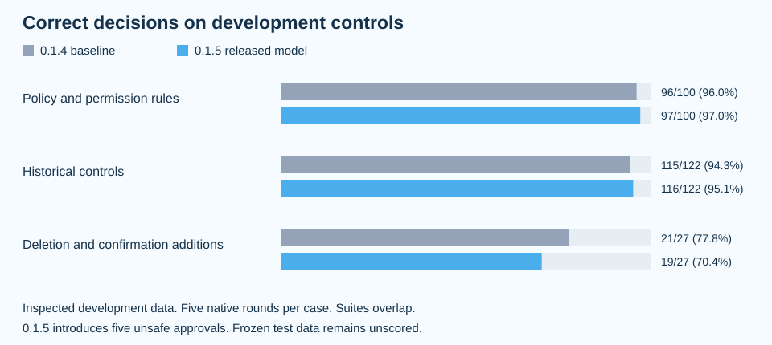

# xor

xor is a safety guard for your AI coding agent.

When you use coding agents like OpenCode, you want them to build features and fix bugs without breaking your project. You do not want them deleting files by mistake, modifying your personal files, or leaking private tokens to the internet. 

xor acts like a polite gatekeeper. Every time the agent wants to run a command or touch a file, xor checks that action against your simple project rules. If it looks safe, xor allows it. If it violates your rules, xor blocks it. If it looks uncertain or risky, xor pauses and asks you for confirmation first.

An optional desktop companion sits on your screen and shows you what your agent is doing in real time.


[Quick Start](#quick-start) · [How It Works](#how-it-works) · [Your Project Rules](#your-project-rules) · [Commands](#commands) · [Model Performance](#model-performance) · [For Developers & Contributors](#for-developers--contributors) · [Documentation](#documentation)

---

## Quick Start

You only need Node.js 22.12 or newer and OpenCode 2.0.30 or newer. On macOS, make sure you have installed Xcode Command Line Tools (`xcode-select --install`).

Install xor globally and run the setup command:

```sh
npm install --global @quaannguyen/xor
xor install
```

`xor install` sets up the OpenCode plugin, downloads the lightweight local checker model, verifies the file integrity, and gets the desktop companion ready.
The model has known missed confirmations; see the measurements and limitations below.

If you prefer installing from source:

```sh
git clone https://github.com/QuaanNguyen/xor.git
cd xor
npm install
node scripts/install-plugin.js
```

---

## How It Works

1. **Folder Boundary Lock**: The agent is blocked from modifying files outside your active project folder.
2. **Rule Protection**: The agent cannot secretly edit your `.xor/preference.json` rules to grant itself extra permissions.
3. **Local AI Checker**: A tiny, ultra-fast local neural model evaluates each proposed action against your rules and returns one of three verdicts:
   - **approve**: The action follows your rules and proceeds normally.
   - **deny**: The action violates your rules. It is blocked immediately, and the agent is informed why.
   - **ask**: The action needs human confirmation. The action is held while OpenCode asks you whether to permit it.

Everything runs entirely on your local machine. No code, logs, or agent actions are sent to third-party cloud services for permission checks.

---

## Your Project Rules

Set your rules in `.xor/preference.json` at the root of your project:

```json
{
  "text": "Work on this repository. Allow local edits and tests. Deny sending source code or secrets to outside services. Ask before deleting files."
}
```

You can write your preferences in plain English. If you do not create this file, xor applies safe default rules automatically.

---

## Commands

| What you want to do | Command |
| :--- | :--- |
| Install the OpenCode plugin and checker model | `xor install` |
| Migrate rules from older installations | `xor migrate` |
| Make the desktop companion smaller | `xor pet size 75` |
| Make the desktop companion larger | `xor pet size 115` |
| Reset the desktop companion to default size | `xor pet size reset` |
| View command options and help | `xor help` |

---

## Model Performance

Version 0.1.5 ships the deletion-and-confirmation model accepted by the owner with a native training fit of **315/323**.
That score measures its own training examples.
The separate development comparison against the 0.1.4 baseline is below.



| Evaluation | 0.1.4 baseline | 0.1.5 model |
| :--- | :--- | :--- |
| Policy and permission rules | 96/100 | 97/100 |
| Historical controls | 115/122 | 116/122 |
| New deletion and confirmation controls | 21/27 | 19/27 |
| Native training fit on the new training examples | Not measured | 315/323 |
| Download size, decimal MB | 63.44 | 63.44 |

The new scenarios cover folder scope and traversal, protected settings, scoped delegation, incomplete action visibility, permission authority, confirmation, and completion evidence.
They also cover archives that preserve originals, archives followed by deletion, requested or prohibited deletion, and removing obsolete code blocks.
Dataset coverage does not mean the hardcoded checks have been removed.
Trusted filesystem and settings checks still run before model decisions.

The development suites contain 241 unique inspected cases and overlap with each other.
Each scored case requires the correct answer in all five native rounds.
The new model introduces five unsafe approvals relative to the baseline and is not a qualified safety improvement.
The frozen test split remains unscored, and no speedup is claimed.
The training diagnostic reports 323/323 verdict leads while actual native generation returns 315/323, so that disagreement remains unresolved.

Download the [0.1.5 weights](https://github.com/QuaanNguyen/xor/releases/download/needle-2026-11-03-e1c8a7c8/needle3.cact) or the [0.1.4 baseline weights](https://github.com/QuaanNguyen/xor/releases/download/needle-2026-11-02-69a83e3e/needle3.cact).
See the [release measurements and categories](docs/model-0.1.5.md) and [per-case results](docs/experiments/model-0.1.5-results.json).

---

## For Developers & Contributors

If you want to contribute, run test suites, or train models, follow these steps:

### Prerequisites
- Node.js 22.12 or newer
- Python 3.10 or newer
- Git and Git LFS

### Setup and Testing
```sh
npm ci
git lfs install
git lfs pull
npm run check
npm test
npm run test:package
node scripts/check-package-client.js npm
```

### Full Desktop Interactive Test Suite
```sh
node test/run-all-tests.js
```

### Training & Architecture Work
- The synthesized training script is located at `scripts/finetune_v3_synthesized.py`.
- Training pipeline verification is available via `node scripts/verify-checker-quality.js`.
- Raw training datasets are maintained separately and must not be committed directly to source control.

---

## Documentation

| Guide | Description |
| :--- | :--- |
| [Project Context](CONTEXT.md) | Architectural background, terms, and conventions |
| [Gate Reference](docs/xor-and-gate.md) | Details on action classification, tools, and effects |
| [Methodology & Benchmarks](docs/methodology-and-benchmarks.md) | Deep dive into fine-tuning techniques and comparative results |
| [Training Guide](docs/checker-training.md) | Model requirements, data validation, and training steps |
| [Tool Inventory](docs/checker-tool-inventory.json) | Comprehensive list of checked agent tools and schemas |
| [Desktop Companion Events](docs/EVENTS.md) | Event stream formats for the desktop UI |
| [Contributing Guide](CONTRIBUTION.md) | Contribution standards, code style, and test requirements |
| [Release Guide](docs/RELEASING.md) | Step-by-step checklist for publishing new versions |
