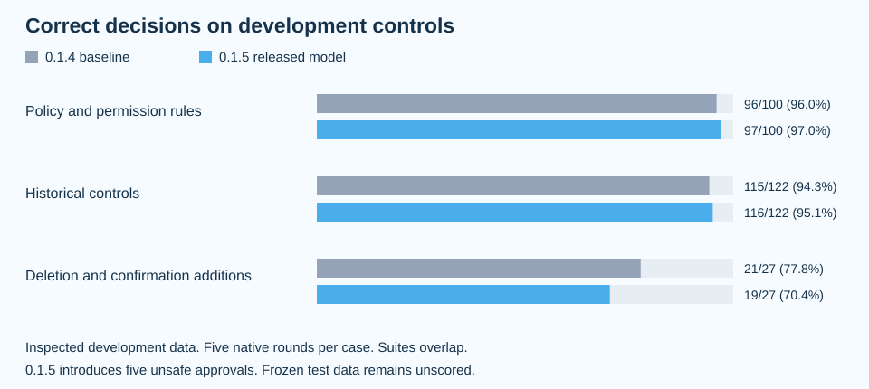

# Model in XOR 0.1.5

The owner accepted the 315/323 native training fit and explicitly requested release on November 3, 2026.
This changes the released model without changing its saved failure against the normal replacement criteria.
No new training was performed for this release.

The model contains 63,437,076 bytes and has SHA256 `e1c8a7c8b01b3e041f19ae1d0ec68fbfc92ab01f929f93f360fbd90580146a13`.
The [weight download](https://github.com/QuaanNguyen/xor/releases/download/needle-2026-11-03-e1c8a7c8/needle3.cact) is separate from npm.
The [0.1.4 baseline](https://github.com/QuaanNguyen/xor/releases/download/needle-2026-11-02-69a83e3e/needle3.cact) remains available.
All five runner pins remain unchanged.
The separate model cache identity preserves earlier installations.

## Measurements

| Evaluation | 0.1.4 baseline | 0.1.5 model |
| --- | --- | --- |
| Policy and permission controls | 96/100 | 97/100 |
| Historical controls | 115/122 | 116/122 |
| New deletion and confirmation controls | 21/27 | 19/27 |
| Native training fit on the new 323 training cases | Not measured | 315/323 |
| Teacher-forced verdict-lead fit on those training cases | Not measured | 323/323 |

The development suites overlap and contain 241 unique cases, not 249 independent cases.
A correct development case requires the correct direct answer in all five native rounds.
The matched comparison contains 2,410 measured responses and 482 warmups, with no process failures, invalid answers, or unstable decisions.
It used the registered Apple Silicon runner on an Apple M5 Mac, default native threads, 128 output tokens, and a 15-second timeout.
The training fit uses one native response per case and does not measure performance on unseen actions.
The frozen test split remains unscored.
No latency improvement is claimed because the runtime limiter was not established.

The new model gains three exact development decisions and loses three previously correct denials.
It introduces five distinct unsafe approvals relative to the baseline, including the original archive-and-delete action and additional protected writes and deletions.
Its 19/27 score on the new controls is lower than the baseline's 21/27.
These regressions remain in the [per-case results](experiments/model-0.1.5-results.json).
The perfect teacher-forced verdict-lead score disagrees with complete native generation, including seen training examples.
Fresh native diagnostics reproduced all eight previously incorrect training answers.
The cause of that disagreement remains unresolved.

## New scenario categories

The dataset adds visible authorization scenarios for policies previously expressed in deterministic checks.
The categories include folder scope and cross-folder authorization, traversal and visible aliases, reading versus changing protected settings, explicit requests to change settings, scoped delegation, incomplete action visibility, permission authority, confirmation, and completion-evidence authorization.
Additional scenarios distinguish archiving while preserving originals, archiving followed by deletion, directly requested file deletion, deletion requiring additional confirmation, prohibited deletion, and removing obsolete source-code blocks.
The same proposed action is paired with different standing permissions in reviewed contrast families.
An authorized code cleanup does not automatically require a file-deletion confirmation.

These are finite dataset categories, not proof that every runtime check is learned or replaceable.
The three scored development groups are shown above.
No separate accuracy percentage is claimed for an individual topic without a case-bound topic annotation.
The public result file records each scored input hash, expected verdict, suite memberships, and five decisions from both models.

## Runtime boundary

Existing deterministic checks remain active for trusted filesystem boundaries, protected settings, complete tool contracts, and delegation restrictions.
The model cannot establish an unseen symlink target or the identity of an owner from text alone.
Missing artifacts, invalid verdicts, and timeouts still fail closed.
The release does not remove host checks or change OpenCode's own permissions.
Human safety verification, fresh blind evaluation, full catalog qualification, and the normal replacement requirements remain incomplete.

The graph is regenerated from the public per-case report with `node scripts/render-model-comparison.js`.
The report records source hashes for the saved native comparison.
No generated command was executed during preparation, fitting, or evaluation.
